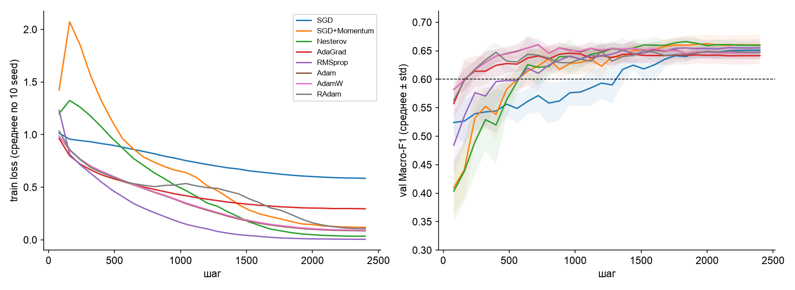
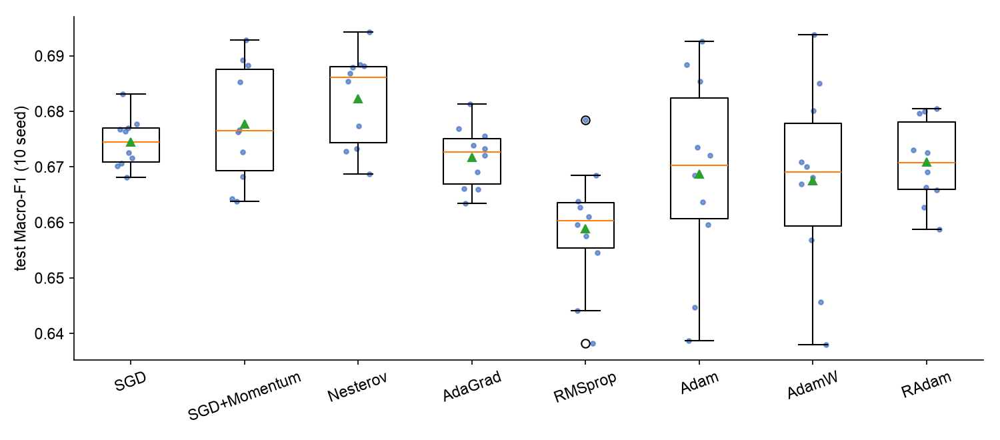
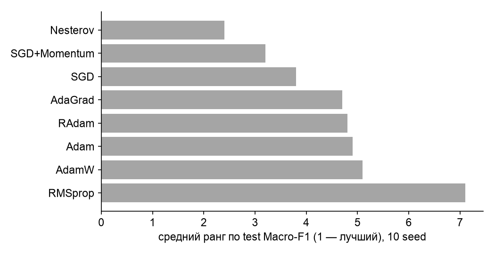

## 4. Единый экспериментальный протокол

| Элемент | Значение (одинаково для всех оптимизаторов) |
|---|---|
| Архитектура | BiGRU (вход 20, скрытый 64 × 2 направления) → [последнее состояние ‖ среднее по времени] → dropout 0,2 → Linear(256 → 4); 34 052 параметра |
| Данные | MTAT train / val / test (раздел 2), class weights в cross-entropy |
| Бюджет | 30 эпох × 80 шагов = **2 400 обновлений**, batch 64, cosine annealing до 0, без warmup |
| Подбор lr | сетка {1/10, 1/3, 1, 3, 10, 30} × базовый lr метода (10⁻² для SGD-семейства и AdaGrad, 10⁻³ для RMSprop / Adam / AdamW / RAdam), 3 seed (100–102), критерий — средний val Macro-F1. Если оптимум на краю сетки, сетка расширяется на шаг ×3 (сработало для SGD, SGD+Momentum, Nesterov, RAdam — оптимум не сдвинулся) |
| Weight decay | 0 (у AdamW — встроенные 10⁻²); влияние weight decay — отдельно в sensitivity |
| Финал | лучший lr, **10 seed** (0–9), тестовое множество не используется при настройке |
| Нестабильность | NaN в loss или финальный train loss выше начального; журнал — `results/unstable_runs.csv` |
| Ресурсы | время обучения на 1 ядре CPU (Apple M3 Pro), память = параметры + состояние оптимизатора (float32) |
| Статистика | 95% t-интервал по 10 seed; критерий Фридмана (блоки — seed); парные Уилкоксона с поправкой Холма; вероятность превосходства P(A > B) по seed; блочный bootstrap исполнителей теста |

**Журнал параметров:** `results/protocol.json`, `best_lr.json`, `A_lr_tuning_all.csv`; кривые — `results/logs/B_final_curves.csv`; шум градиента — `B_final_noise.csv`.

## 5. Сравнение оптимизаторов (10 seed)

| Оптимизатор | lr* | Val F1 | Test F1 [95% ДИ по seed] | Std | Min | ECE (test) | Шагов до val F1 ≥ 0,60 (медиана) | Время, с | Память, КБ | Нестабильных |
|---|---|---|---|---|---|---|---|---|---|---|
| SGD | 0,3 | 0,651 | 0,674 [0,671; 0,678] | **0,005** | 0,668 | **0,059** | 1 000 | 30,8 | **133** | 0/10 |
| SGD+Momentum | 0,3 | **0,660** | 0,678 [0,670; 0,685] | 0,011 | 0,664 | 0,207 | 560 | 39,3 | 266 | 0/10 |
| **Nesterov** | 0,3 | **0,660** | **0,682** [0,676; 0,688] | 0,009 | **0,669** | 0,230 | 640 | 30,9 | 266 | 0/10 |
| AdaGrad | 0,03 | 0,641 | 0,672 [0,668; 0,676] | 0,006 | 0,663 | 0,149 | **160** | 33,3 | 266 | 0/10 |
| RMSprop | 0,01 | 0,655 | 0,659 [0,651; 0,667] | 0,011 | 0,638 | 0,265 | 400 | 31,3 | 266 | 0/10 |
| Adam | 0,003 | 0,647 | 0,669 [0,656; 0,681] | 0,018 | 0,639 | 0,216 | 200 | 34,1 | 399 | 0/10 |
| AdamW | 0,003 | 0,647 | 0,668 [0,655; 0,680] | 0,017 | 0,638 | 0,213 | 200 | 33,6 | 399 | 0/10 |
| RAdam | 0,03 | 0,648 | 0,671 [0,665; 0,676] | 0,008 | 0,659 | 0,195 | 240 | 33,4 | 399 | 0/10 |

### Статистический протокол

- **Критерий Фридмана** (8 методов, 10 спаренных seed): χ² = 23,3, **p = 0,0015** — различия между оптимизаторами в целом есть.
- **Средние ранги** (1 — лучший): Nesterov 2,4; SGD+Momentum 3,2; SGD 3,8; AdaGrad 4,7; RAdam 4,8; Adam 4,9; AdamW 5,1; RMSprop 7,1.
- **Попарно с лидером по val** (SGD+Momentum), Уилкоксон с поправкой Холма: **ни одно различие не значимо** (минимальное p_holm = 0,068 против RMSprop, разница +0,019). Вероятность превосходства лидера над остальными — 0,6–0,8.
- **Блочный bootstrap исполнителей теста** даёт ДИ шириной около 0,2 для всех методов (например, Nesterov [0,542; 0,750], RMSprop [0,494; 0,730]). Неопределённость из-за того, **какие исполнители попали в тест**, в 10 раз больше разницы между оптимизаторами.

### Сходимость, валидация и обобщение — по отдельности

1. **Скорость сходимости:** адаптивные методы быстрее всех доходят до val F1 0,60 — AdaGrad за 160 шагов, Adam / AdamW за 200, RAdam за 240. SGD-семейству нужно 560–1 000 шагов. **H1 подтверждена.**
2. **Качество на валидации:** лучшие — SGD+Momentum и Nesterov (0,660), адаптивные — 0,641–0,655.
3. **Обобщение (тест):** разброс средних всего 0,659–0,682, лучшие методы статистически неразличимы. **H2 подтверждена.** Минимизация train loss и обобщение расходятся: RMSprop и Nesterov сильнее всех снижают train loss (0,005 и 0,034), но RMSprop — худший на тесте. SGD недообучен (train loss 0,59), но держится на уровне лучших и **единственный хорошо калиброван** (ECE 0,06 против 0,15–0,27). Это согласуется с Wilson et al. (2017): адаптивность ускоряет оптимизацию, но не улучшает обобщение.

### Правило выбора

1. Кандидат допускается, если у него не больше 1 нестабильного запуска из 10 (допущены все 8).
2. Сводный балл **по валидации** (тест в выборе не участвует): 40% средний val F1, 20% разброс val F1 (меньше — лучше), 15% val ECE, 15% медиана шагов до цели, 10% память. Компоненты нормированы min–max.

| Оптимизатор | Сводный балл |
|---|---|
| **Nesterov** | **0,711** |
| SGD | 0,600 |
| SGD+Momentum | 0,563 |
| RMSprop | 0,485 |
| Adam | 0,409 |
| AdamW | 0,407 |
| RAdam | 0,405 |
| AdaGrad | 0,320 |

**Выбран Nesterov** (lr 0,3, momentum 0,9): максимальный балл, лучший средний ранг и лучший худший случай (min 0,669). Его преимущество над остальными **статистически не доказано**. Это выбор надёжного компромисса, а не «лучшего метода».
