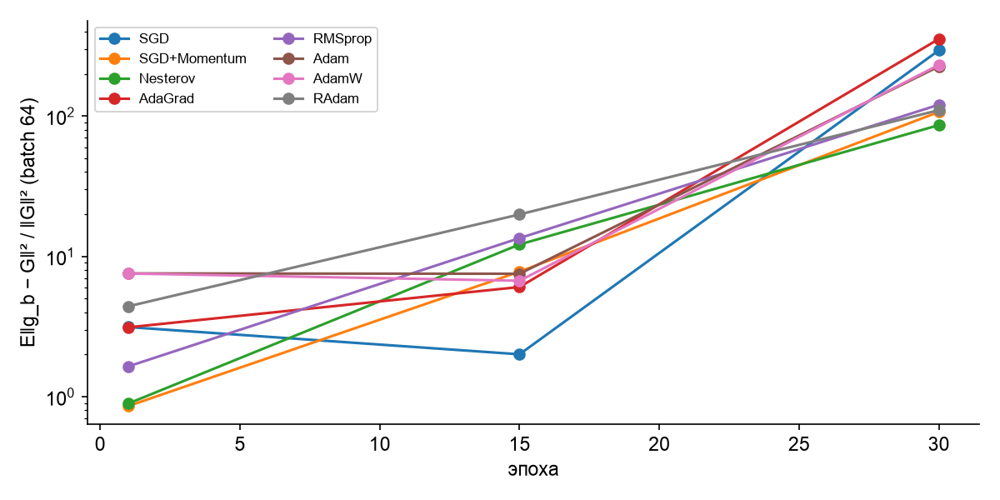

## 6. Стохастический анализ

### 6.1 Шум градиента

Отношение E‖g_b − G‖² / ‖G‖² (g_b — градиент по mini-batch из 64 объектов, G — полный градиент по train; 16 батчей; среднее по 10 seed):

| Оптимизатор | Эпоха 1 | Эпоха 15 | Эпоха 30 |
|---|---|---|---|
| SGD | 3,1 | 2,0 | 294 |
| SGD+Momentum | 0,9 | 7,8 | 107 |
| Nesterov | 0,9 | 12,2 | 86 |
| AdaGrad | 3,1 | 6,1 | 355 |
| RMSprop | 1,6 | 13,5 | 121 |
| Adam | 7,6 | 7,5 | 226 |
| AdamW | 7,6 | 6,7 | 232 |
| RAdam | 4,4 | 19,9 | 110 |

В начале обучения отношение порядка 1–8: градиент батча в целом указывает в сторону полного. К концу полный градиент почти исчезает (модель у минимума train loss), и отношение вырастает до 86–355. Обновления становятся почти чистым шумом, поэтому затухающий шаг (cosine) важен. Сильный шум в конце — аргумент против допущения «ограниченной дисперсии относительно ‖G‖», и он объясняет разброс итоговых метрик по seed. Самый «шумный» финал у AdaGrad и SGD, самый спокойный — у Nesterov и SGD+Momentum.

### 6.2 Распределение итоговых метрик и вклад источников случайности

Std тестового Macro-F1, когда варьируется **только один** источник (10 значений):

| Источник | SGD+Momentum | RMSprop |
|---|---|---|
| только инициализация | 0,011 | 0,015 |
| только порядок батчей | **0,016** | 0,015 |
| только dropout | 0,010 | 0,015 |
| bootstrap обучающих исполнителей | 0,007 (среднее F1 падает до 0,637) | 0,008 (до 0,633) |
| все вместе (фаза B, 10 seed) | 0,011 | 0,012 |
| **для сравнения:** размах средних 8 оптимизаторов | 0,023 | |
| **для сравнения:** ширина ДИ блочного bootstrap тестовых исполнителей | ≈ 0,20 | ≈ 0,24 |

**Выводы:**
1. Каждый отдельный источник случайности — инициализация, порядок, dropout — даёт std 0,010–0,016. Это **половина и больше всего размаха между оптимизаторами** (0,023). Поэтому сравнение по одному seed может дать любой порядок методов. **H3 подтверждена.**
2. Источники не складываются: std при варьировании всего (0,011) не больше отдельных. Траектория обучения хаотична, и любой источник перемешивает итог.
3. **Самая большая неопределённость — состав тестовой выборки** (33 исполнителя): ДИ ≈ ±0,1. Bootstrap обучающих исполнителей снижает среднее (повторы исполнителей = меньше разнообразия), но разброс при этом небольшой.

### 6.3 Чувствительность (5 seed, test Macro-F1; база: lr*, batch 64, wd 0)

| Фактор | Значение | SGD+Momentum | RMSprop | RAdam |
|---|---|---|---|---|
| база | — | 0,677 | 0,662 | 0,671 |
| learning rate | lr* / 3 | **0,682** | 0,663 | 0,671 |
| | lr* × 3 | 0,541 | 0,603 | 0,551 |
| batch size (lr тот же, эпохи те же) | 32 | 0,580 (std 0,036) | 0,665 | 0,611 (std 0,031) |
| | 128 | 0,679 | 0,657 | 0,673 |
| | 256 | 0,677 | 0,653 | 0,664 |
| weight decay | 10⁻⁴ | 0,681 | 0,673 | 0,689 |
| | **10⁻³** | **0,702** | **0,685** | **0,690** |
| | 10⁻² | 0,661 | 0,666 | 0,668 |

1. **lr — главный фактор:** ×3 от оптимума обрушивает качество на 0,06–0,14. Уменьшение в 3 раза почти безопасно. Асимметрия: ошибиться вниз дешевле.
2. **Batch 32 при том же lr** удваивает «температуру» шума lr / B (Smith & Le, 2018). SGD+Momentum и RAdam проседают на 0,06–0,10, и резко растёт разброс по seed. RMSprop нечувствителен: нормировка по второму моменту гасит масштаб шума.
3. **Weight decay 10⁻³ улучшает все три метода** (+0,019…+0,025). С ним SGD+Momentum даёт лучший результат эксперимента — **0,702**. Основная настройка (wd = 0) недорегуляризована. Улучшение от правильного wd сопоставимо со всей разницей между оптимизаторами или больше неё.

### 6.4 Стохастические сценарии входного ряда (модели обучены на чистых данных; 5 реализаций сценария на модель, среднее по 10 seed)

Допущения сценариев (подробно — `src/scenarios.py`):
- **OU** — аддитивная коррелированная во времени помеха, θ = 0,5, σ = 0,5 std признака.
- **GBM** — мультипликативный дрейф усиления, s = 0,15 на шаг, влияет только на громкость (RMS в дБ).
- **Markov-switching** — два режима «чистый / деградированный», P(остаться) = 0,9 / 0,8, в деградированном режиме гауссов шум σ = 1.

Синтетика иллюстрирует устойчивость и **не заменяет реальный тест**.

| Оптимизатор | Чистый тест | OU | GBM (громкость) | Markov-switching |
|---|---|---|---|---|
| SGD | 0,674 | 0,566 | **0,669** | 0,573 |
| SGD+Momentum | 0,678 | 0,573 | 0,664 | 0,565 |
| Nesterov | **0,682** | 0,562 | **0,670** | 0,555 |
| AdaGrad | 0,672 | 0,568 | 0,654 | 0,562 |
| RMSprop | 0,659 | **0,578** | 0,648 | **0,576** |
| Adam | 0,669 | 0,563 | 0,654 | 0,558 |
| AdamW | 0,668 | 0,563 | 0,654 | 0,558 |
| RAdam | 0,671 | 0,570 | 0,657 | 0,563 |

1. **Коррелированный шум (OU) и переключение режимов** снижают качество на 0,08–0,13 у всех методов. Это крупнейший эффект во всей работе, на порядок больше разницы между оптимизаторами.
2. **Дрейф громкости (GBM)** почти безвреден (−0,005…−0,018): от громкости зависит лишь 1 признак из 20.
3. **Порядок методов в сценариях меняется:** RMSprop, худший на чистых данных, становится лучшим под шумом (0,578 / 0,576), а лидер Nesterov — одним из худших (0,562 / 0,555). Выбор оптимизатора по чистому тесту не гарантирует устойчивости к режиму входа.
